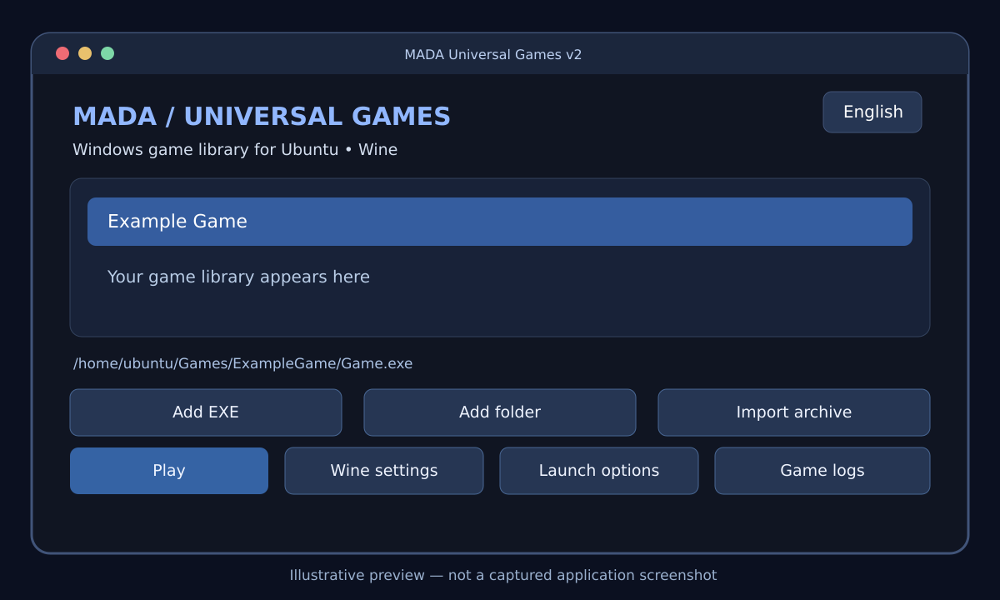
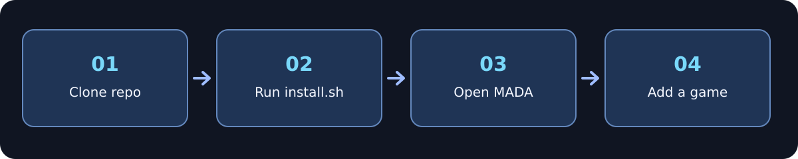

<div align="center">


# MADA Universal Games

**Windows game launcher for Ubuntu • مشغّل ألعاب ويندوز على أوبونتو**


[English](#english) · [العربية](#العربية)



*Illustration of the application's controls, **not an actual screenshot**. | رسم توضيحي وليس لقطة شاشة فعلية.*

</div>

---

## English

### About

MADA Universal Games is an experimental, open-source-style Python/PyQt6 desktop launcher that organizes locally owned Windows games and attempts to run them on Ubuntu through [Wine](https://www.winehq.org/). It is **not a Windows emulator**, and game compatibility is not guaranteed.

### Features

- Switch between Arabic (right-to-left) and English.
- Add a Windows game by selecting its `.exe` file or folder.
- Import games from supported `.rar`, `.zip`, and `.7z` archives using `unar`.
- Keep a separate Wine prefix for every game.
- Set launch arguments and open `winecfg`.
- View game logs, rename entries, and remove games from the library without deleting the files.
- **Check / fix requirements:** inspect game EXEs and recent Wine errors for .NET/Wine Mono, XNA, Visual C++ and DirectX 9 clues.
- Download **Wine Mono from WineHQ** and install it into the selected game's Wine prefix after an explicit confirmation.
- Optionally install selected Windows runtime components via **Winetricks** (separate package, not installed by default).
- Detect common redistributable installers accidentally selected as the game executable and warn before adding them.
- Local library metadata stored in `~/.config/mada-universal-games/library.json`.

### Requirements

- Ubuntu desktop (dependency package names and availability depend on your release).
- Internet access **during initial package installation**.
- Python 3, PyQt6, Wine, `unar`, and Noto Arabic fonts.
- Enough storage for both your games and Wine prefixes.

### Installation



Open Terminal and run:

```bash
sudo apt update
sudo apt install -y git
git clone https://github.com/attack988/MADA-Universal-Games.git
cd MADA-Universal-Games
chmod +x install.sh
./install.sh
```

The installer uses `sudo apt` to install system dependencies and places the launcher in `~/.local/share/mada-universal-games`. **Review `install.sh` before running it.**

After installation, launch **MADA Universal Games** from the Ubuntu application menu, or run:

```bash
~/.local/share/mada-universal-games/run.sh
```

### Using the launcher

1. Select **English** or **العربية** in the language menu.
2. Choose **Add EXE**, **Add folder**, or **Import archive**.
3. For folders/archives, select the actual game executable rather than an uninstaller.
4. Select your game and press **Play**. A separate Wine prefix will be created for it as required.
5. If a game does not launch, click **Check / fix requirements**. Review the detected clues and explicitly approve a suggested component. Try the game again afterward.
6. If the log mentions `Wine Mono is not installed`, select **Wine Mono** first. Installation downloads the official MSI over HTTPS to `~/.cache/mada-universal-games` and runs it in that game's isolated prefix.
7. For **XNA 4, Visual C++ 2019, DirectX 9, or native .NET 4.0**, first install Winetricks if it is not present: `sudo apt install winetricks`. The launcher asks for consent before running any Winetricks verb.

> **Compatibility:** Windows components do not work in every Wine version. Native .NET Framework installation may replace Wine Mono and affect existing games in that prefix. Back up important prefix data before advanced changes. No packages, dependencies, or game files are installed without your approval. Detection is heuristic, not an exhaustive compatibility scan.

### Updating an existing installation

```bash
cd MADA-Universal-Games
git pull --ff-only
./install.sh
```

This refreshes the installed launcher; game library metadata and existing game folders live outside the repository. Back up important files before upgrading.

### Troubleshooting

- **`apt update` fails:** inspect and repair any broken third-party APT repositories first. Do not disable signature verification.
- **PyQt6 missing:** run the installer again and ensure `python3-pyqt6` is installed.
- **Wine not installed:** install `wine` from your Ubuntu repository or consult WineHQ for your exact Ubuntu release.
- **Game crashes or will not start:** click **Check / fix requirements** to inspect the latest Wine errors. The log now retains error messages instead of suppressing them; Vulkan/driver warnings alone are not proof of failure.
- **Arabic text looks wrong:** install `fonts-noto-core` and restart the application. Arabic RTL handling applies to the *launcher*, not to text inside games.

### Safety and project status

**Early experimental release:** not all Windows games work with Wine, and the installer has not been tested across every Ubuntu release. Only run executables you trust: **Wine is not a malware sandbox**. This repository includes **no game files, DRM bypass tools, or copyrighted game assets**. Obtain games from authorized sources. There is currently no license file, so do not assume permission to reuse or redistribute the code beyond what copyright law allows.

---

## العربية

### ما هو البرنامج؟

**MADA Universal Games** مشروع تجريبي بواجهة رسومية باستخدام Python وPyQt6، يساعدك على تنظيم ألعاب Windows الموجودة لديك وتشغيل الألعاب المتوافقة على Ubuntu بواسطة **Wine**. البرنامج ليس محاكيًا كاملًا لويندوز، ولا يضمن تشغيل كل الألعاب.

### المميزات

- واجهة **عربية وإنجليزية** مع دعم اتجاه القراءة من اليمين لليسار.
- إضافة لعبة من ملف `EXE` أو من مجلد كامل.
- استيراد ملفات `RAR` و`ZIP` و`7Z` باستخدام `unar`.
- إنشاء بيئة Wine مستقلة لكل لعبة.
- تخصيص أوامر التشغيل وفتح إعدادات Wine.
- عرض سجل الأخطاء وإعادة تسمية الألعاب وإزالتها من القائمة دون حذف ملفات اللعبة.
- زر **🧰 فحص وإصلاح المتطلبات** للتعرّف على مؤشرات نقص Wine Mono و.NET وXNA وVisual C++ وDirectX.
- تنزيل Wine Mono من المصدر الرسمي وتثبيته في بيئة Wine للعبة المحددة بعد موافقتك.
- تثبيت مكونات Windows الأخرى عند اختيارها باستخدام Winetricks، مع تحذير عند اختيار ملف تثبيت متطلبات بدل ملف اللعبة.
- حفظ بيانات المكتبة محليًا على جهازك.

### المتطلبات

- نظام Ubuntu بواجهة سطح مكتب.
- اتصال إنترنت عند تثبيت المتطلبات لأول مرة.
- Python 3 وPyQt6 وWine وunar وخطوط Noto Arabic.
- مساحة كافية للألعاب وملفات Wine الإضافية.

### طريقة التثبيت


افتح **Terminal** ثم انسخ الأوامر التالية:

```bash
sudo apt update
sudo apt install -y git
git clone https://github.com/attack988/MADA-Universal-Games.git
cd MADA-Universal-Games
chmod +x install.sh
./install.sh
```

يستخدم المثبّت صلاحية `sudo` لتثبيت المتطلبات من مستودعات Ubuntu، ثم ينسخ ملفات البرنامج إلى مجلد المستخدم. **راجع محتوى `install.sh` قبل تشغيله.**

بعد اكتمال التثبيت افتح **MADA Universal Games** من قائمة التطبيقات، أو شغّله بالأمر:

```bash
~/.local/share/mada-universal-games/run.sh
```

### كيفية إضافة وتشغيل لعبة

1. اختر اللغة **العربية** أو **English** من أعلى النافذة.
2. اضغط **إضافة EXE** أو **إضافة مجلد** أو **استيراد RAR/ZIP**.
3. اختر ملف تشغيل اللعبة الصحيح، وليس ملف إزالة التثبيت.
4. اختر اللعبة من القائمة واضغط **تشغيل**.
5. إذا لم تعمل اللعبة، اضغط **🧰 فحص وإصلاح المتطلبات** لعرض الرسائل واختيار المكوّن المقترح.
6. إذا ظهرت رسالة `Wine Mono is not installed`، جرّب **Wine Mono** أولًا، وافق على التنزيل والتثبيت، ثم شغّل اللعبة مجددًا.
7. للتثبيت المتقدم مثل XNA و.NET الأصلي استخدم `sudo apt install winetricks` إن لم يكن مثبتًا.

> **تنبيه:** فحص المتطلبات يعتمد على مؤشرات من ملف اللعبة والسجل، ولا يضمن نجاح كل لعبة. لا يتم تثبيت أي شيء دون الموافقة. قد يُغيّر تثبيت .NET الأصلي إعدادات Wine Mono؛ احتفظ بنسخة احتياطية من ملفاتك المهمة قبل التجربة.

### تحديث البرنامج

من مجلد المشروع الذي استنسخته سابقًا:

```bash
cd MADA-Universal-Games
git pull --ff-only
./install.sh
```

لا يُفترض أن يحذف التحديث مكتبة ألعابك؛ ملفاتها وإعداداتها محفوظة خارج مجلد المستودع. يُفضّل نسخ البيانات المهمة احتياطيًا قبل أي تحديث.

### حل المشكلات الشائعة

| المشكلة | الحل |
|---|---|
| فشل `apt update` | أصلح المستودع الخارجي الذي يظهر في الخطأ، ولا تتجاوز التحقق من التوقيع |
| مكتبة PyQt6 غير موجودة | أعد التثبيت وتأكد من وجود `python3-pyqt6` |
| Wine غير مثبت | ثبّته من مستودع Ubuntu أو من تعليمات WineHQ المتوافقة مع إصدارك |
| اللعبة لا تعمل | افحص سجل الأخطاء ومتطلبات اللعبة ومدى توافقها مع Wine |
| العربية غير متصلة | ثبّت `fonts-noto-core` وأعد فتح المشغّل؛ هذا لا يصلح الخطوط داخل الألعاب |

### ملاحظات مهمة

هذه **نسخة تجريبية**، ولم تُختبر على جميع إصدارات Ubuntu. لا تشغّل ملفات EXE من مصادر غير موثوقة؛ Wine لا يعزل البرامج الضارة. المشروع **لا يحتوي على ألعاب أو أدوات تجاوز حماية أو ملفات ألعاب محمية بحقوق النشر**. استخدم نسخ الألعاب المصرّح لك بها. ولم تُحدَّد رخصة قانونية للكود حتى الآن.

---

<div align="center">

**Built for Ubuntu gaming · صُنع لمحبي الألعاب على أوبونتو**

[Report a problem](https://github.com/attack988/MADA-Universal-Games/issues)

</div>
