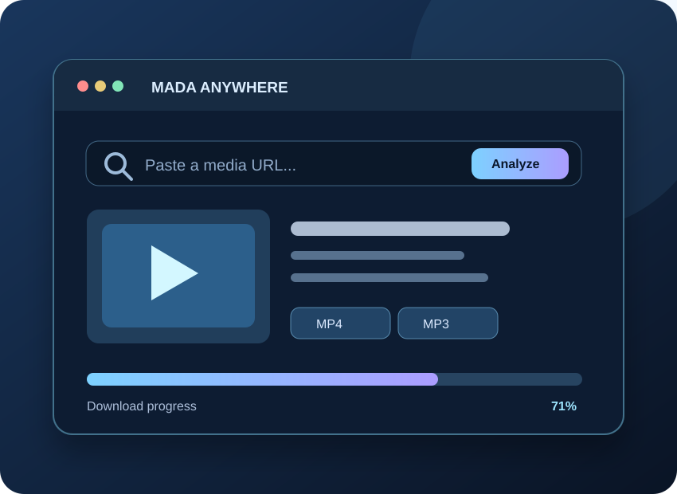

<div align="center">



# MADA Anywhere
### احفظ الوسائط المصرّح بها في مكان واحد · Your media, your choice

**واجهة أنيقة ومتجاوبة لتنزيل الصوت والفيديو من المصادر المدعومة، مع أدوات تحكم وسجل تنزيلات.**


[**🖼️ Preview website**](../../docs/anywhere/index.html) · [**📦 Download source ZIP**](./MADA_Anywhere_v2.zip) · [**🔒 SHA256**](./SHA256.txt)

*Preview above is an original SVG illustration, not a screenshot from a tested video download.*

</div>

---

## 🇸🇦 العربية

**MADA Anywhere** تطبيق تجريبي بواجهة عربية وإنجليزية لإدارة تنزيلات الوسائط التي يحق لك حفظها. يتعامل مع الروابط المدعومة بواسطة `yt-dlp`، مع اختيار الصيغة والجودة عند توفرها. لا يتجاوز حماية DRM.

### ✨ المميزات

| الميزة | التفاصيل |
|:--|:--|
| 🔗 تحليل الروابط | عنوان الفيديو وصورته والمعلومات المتاحة من الموقع |
| 🎥 الفيديو والصوت | MP4 / MP3 / M4A حسب المصدر وFFmpeg |
| 📊 التنزيلات | تقدم التحميل، قائمة المهام وإعادة المحاولة |
| 🌗 التصميم | دعم العربية والإنجليزية وواجهة متجاوبة |
| 🔐 الاتصال البعيد | خادم خاص برمز وصول عبر HTTPS |
| 📱 الهاتف | واجهة PWA؛ تشغيل المحرك يختلف حسب النظام |

### 🖥️ تشغيل Ubuntu

إذا كنت تستخدم **MADA Suite** يمكنك تشغيل برنامجي الألعاب والتنزيلات معًا:

```bash
curl -fsSLo ~/mada-suite.sh https://raw.githubusercontent.com/attack988/MADA-Universal-Games/main/mada-suite.sh
bash ~/mada-suite.sh setup
~/.local/bin/mada start
```

للتشغيل المستقل، فك ضغط الملف ثم نفّذ من داخل مجلده:

```bash
bash install_ubuntu_mac.sh
bash start_ubuntu_mac.sh
```

افتح `http://127.0.0.1:8787`، وثبّت FFmpeg مسبقًا عند الحاجة لدمج الصوت والفيديو أو إنتاج MP3.

### 🌍 الأنظمة الأخرى

| النظام | الواجهة | محرك التحميل |
|:--|:--|:--|
| Ubuntu / Linux | متصفح / PWA | Python محلي |
| Windows | متصفح / PWA | Python محلي |
| macOS | متصفح / PWA | Python محلي |
| Android | Chrome / PWA | Termux أو خادم خاص |
| iPhone / iPad | Safari / PWA | **خادم HTTPS خارجي ضروري** |

**مهم:** هذا ليس ملف APK أو IPA أصليًا، وGitHub Pages لا يقوم بتشغيل خادم Python. للتنزيل عبر الإنترنت من iPhone، استضف محرك التنزيل بنفسك بشكل آمن، ثم اربط الواجهة بخادم HTTPS محمي. لا تنشر مفاتيح `.env` ولا تفتح الخادم للعامة دون مصادقة.

---

## 🇬🇧 English

MADA Anywhere is an experimental cross-platform media download manager. It offers link inspection, supported audio/video formats, a job queue, progress tracking, and a responsive Arabic/English PWA.

**Quick start:** Download and extract the source ZIP. On Linux/macOS run `bash install_ubuntu_mac.sh && bash start_ubuntu_mac.sh` after setting up Python 3.11+ and FFmpeg. On Windows run `install_windows.bat`, then `start_windows.bat`. On Android use the included Termux scripts.

**Remote use:** Browser UI can run anywhere, but download processing requires a private Python backend over HTTPS. iPhone/iPad do not run yt-dlp natively inside the PWA. Supported sites and live download behavior vary; no bypass of DRM is provided. Download only media you are authorized to save.

### 📂 Project links

- [Original application package](./MADA_Anywhere_v2.zip)
- [Illustrated project page](../../docs/anywhere/index.html)
- [GitHub Pages publishing workflow](../../.github/workflows/publish-site.yml)
- [Unified MADA Suite launcher](../../mada-suite.sh)

**Stage:** experimental (v2). Local tests do not guarantee compatibility with every video source or platform.
